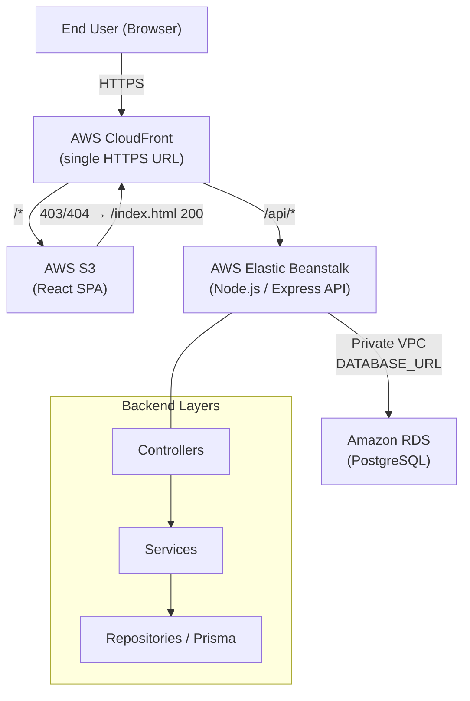

# Design Document — Task Manager App

## Overview

The Task Manager App is a full-stack web application that allows registered users to manage personal tasks. It follows a strict layered architecture with the frontend served from AWS S3 + CloudFront, the REST API running on AWS Elastic Beanstalk, and the database hosted on Amazon RDS for PostgreSQL.

**Key design goals:**

- Clean separation of concerns via a three-layer backend (controller → service → repository).
- Stateless authentication using JWTs so the API tier can scale horizontally without session state.
- A single public HTTPS entry point (CloudFront) that routes `/api/*` requests to the backend and all other paths to the S3-hosted SPA, including SPA-friendly 403/404 → `/index.html` fallback.
- Role-based access control: `USER` for standard task operations, `ADMIN` for master-data maintenance.
- All configuration via environment variables — no secrets in source code.

---

## Architecture

### Layered Architecture Diagram

```
┌─────────────────────────────────────────────────────────────────┐
│                         End User (Browser)                      │
└─────────────────────────────┬───────────────────────────────────┘
                              │ HTTPS
                              ▼
┌─────────────────────────────────────────────────────────────────┐
│                  AWS CloudFront Distribution                    │
│  ┌─────────────────────────────────────────────────────────┐   │
│  │  Behaviour: /api/*  ──────────────────────────────────► │──► Elastic Beanstalk (API)
│  │  Behaviour: /*      ──────────────────────────────────► │──► S3 Bucket (Frontend)
│  │  Error responses: 403/404 from S3 → /index.html HTTP 200│   │
│  └─────────────────────────────────────────────────────────┘   │
└─────────────────────────────────────────────────────────────────┘
         │ (non-/api/*)                    │ (/api/*)
         ▼                                 ▼
┌─────────────────────┐       ┌────────────────────────────────────┐
│   AWS S3 Bucket     │       │  AWS Elastic Beanstalk (Node.js)   │
│  (React SPA assets) │       │                                    │
│  index.html         │       │  ┌──────────────────────────────┐  │
│  assets/            │       │  │  Express App (TypeScript)    │  │
└─────────────────────┘       │  │                              │  │
                               │  │  Middlewares:               │  │
                               │  │    - JWT auth               │  │
                               │  │    - Role guard (ADMIN)     │  │
                               │  │    - Zod validation         │  │
                               │  │    - Centralised error handler│ │
                               │  │                              │  │
                               │  │  Routes → Controllers       │  │
                               │  │       ↓                     │  │
                               │  │     Services                │  │
                               │  │       ↓                     │  │
                               │  │    Repositories (Prisma)    │  │
                               │  └──────────────┬─────────────┘  │
                               └─────────────────┼────────────────┘
                                                 │ Private VPC
                                                 ▼
                               ┌────────────────────────────────────┐
                               │  Amazon RDS for PostgreSQL         │
                               │  (not publicly accessible)         │
                               └────────────────────────────────────┘
```

### Mermaid Diagram



### Request Flow

1. Browser sends HTTPS request to the CloudFront URL.
2. CloudFront inspects the path:
   - `/api/*` → forwarded to the Elastic Beanstalk origin (real HTTP status codes preserved).
   - Everything else → served from S3; if S3 returns 403 or 404, CloudFront responds with `/index.html` and HTTP 200 (SPA client-side routing).
3. The Express app processes the request through middleware (JWT auth → role guard → Zod validation) then delegates to the appropriate controller → service → repository chain.
4. The repository uses Prisma to query/mutate the RDS PostgreSQL database.

---

## Components and Interfaces

### Backend Components

#### Auth Module (`/backend/src/`)
- **Route**: `POST /api/auth/register`, `POST /api/auth/login`
- **Controller** (`controllers/auth.controller.ts`): Parses request body, calls `AuthService`, returns HTTP response.
- **Service** (`services/auth.service.ts`): Validates input via Zod, checks uniqueness, hashes passwords with bcrypt (cost ≥ 10), issues JWTs (24 h expiry), detects first-user ADMIN promotion.
- **Repository** (`repositories/user.repository.ts`): Prisma queries for `User` entity.

#### Task Module
- **Route**: `GET/POST /api/tasks`, `GET/PATCH/DELETE /api/tasks/:id`
- **Controller** (`controllers/task.controller.ts`): Extracts authenticated user from `req.user`, delegates to `TaskService`.
- **Service** (`services/task.service.ts`): Business rules — ownership enforcement, field validation, partial updates, filter query building.
- **Repository** (`repositories/task.repository.ts`): Prisma CRUD + filtered list queries.

#### Report Module
- **Route**: `GET /api/reports`
- **Controller** (`controllers/report.controller.ts`): Calls `ReportService`, returns JSON.
- **Service** (`services/report.service.ts`): Computes counts by status, overdue count (dueDate < today AND status ≠ done), upcoming tasks (dueDate in [today, today+7] AND status ≠ done).
- **Repository** (`repositories/report.repository.ts`): Aggregation/groupBy queries via Prisma.

#### Maintenance Module
- **Route**: `GET/POST /api/admin/categories`, `GET/PATCH/DELETE /api/admin/categories/:id`, equivalent for priorities.
- **Controller** (`controllers/maintenance.controller.ts`): ADMIN-guarded; delegates to `MaintenanceService`.
- **Service** (`services/maintenance.service.ts`): Validates name (non-empty, ≤ 100 chars), checks case-insensitive uniqueness, prevents deletion when entity is in use.
- **Repository** (`repositories/category.repository.ts`, `repositories/priority.repository.ts`).

#### Health Endpoint
- **Route**: `GET /api/health` (public, no auth)
- Returns `{ "status": "ok" }` with HTTP 200. Used as the Elastic Beanstalk health check target.

#### Middlewares (`/backend/src/middlewares/`)
| File | Responsibility |
|---|---|
| `auth.middleware.ts` | Validates Bearer JWT (structure + signature + `exp`); attaches decoded payload to `req.user` |
| `role.middleware.ts` | Guards `/api/admin/*` routes; returns HTTP 403 if role ≠ `ADMIN` |
| `validate.middleware.ts` | Wraps Zod schema parsing; returns HTTP 400 with field-level error list on failure |
| `error.middleware.ts` | Centralised Express error handler; formats `{ status, message, timestamp }` responses |
| `notFound.middleware.ts` | Catch-all 404 handler for undefined routes |

#### Shared Utilities (`/backend/src/utils/`)
- `jwt.ts` — sign / verify helpers wrapping `jsonwebtoken`.
- `bcrypt.ts` — hash / compare helpers wrapping `bcryptjs`.
- `AppError.ts` — custom error class carrying HTTP status code and message.
- `envValidator.ts` — validates required env vars at startup; exits with non-zero code if any are missing.

### Frontend Components

#### Pages (`/frontend/src/pages/`)
| Page | Route | Auth required |
|---|---|---|
| `LoginPage` | `/login` | No |
| `RegisterPage` | `/register` | No |
| `TaskListPage` | `/tasks` | Yes |
| `ReportsPage` | `/reports` | Yes |
| `MaintenancePage` | `/maintenance` | Yes (ADMIN only) |

#### Key Reusable Components (`/frontend/src/components/`)
- `Navbar` — shows/hides Mantenimiento link based on role from `AuthContext`.
- `TaskForm` — create/edit task; includes title, description, dueDate, category dropdown, priority dropdown.
- `TaskCard` — displays a single task with edit/delete actions; delete triggers `ConfirmDialog`.
- `ConfirmDialog` — modal confirmation before destructive API calls.
- `FilterBar` — status dropdown + two date pickers for start/end date.
- `ReportChart` — Recharts bar or pie chart for task-count-by-status.
- `ReportCard` — numeric summary for overdue count.
- `UpcomingTaskList` — list rendering for upcoming tasks (title + dueDate).
- `Notification` — toast-style success/error notification.

#### Services (`/frontend/src/services/`)
- `auth.service.ts` — register, login calls.
- `task.service.ts` — CRUD + filtered list calls.
- `report.service.ts` — `GET /api/reports` with 10 s timeout.
- `maintenance.service.ts` — category and priority CRUD.
- `lookup.service.ts` — read-only `GET /api/categories` and `GET /api/priorities` for dropdown population.
- `api.ts` — Axios instance configured with `baseURL`, Bearer token injection interceptor, 401 redirect interceptor.

#### State Management (`/frontend/src/context/`)
- `AuthContext` — stores JWT and decoded user (id, role); provides `login`, `logout` functions; persists token in `localStorage`.

#### Routing
React Router v6 with protected route wrapper (`ProtectedRoute`) that checks `AuthContext`; unauthenticated users are redirected to `/login`.

### REST API Endpoint Reference

| Method | Path | Auth | Role | Description |
|---|---|---|---|---|
| `POST` | `/api/auth/register` | No | — | Register new user; returns JWT |
| `POST` | `/api/auth/login` | No | — | Log in; returns JWT |
| `GET` | `/api/health` | No | — | Health check; returns `{ status: "ok" }` |
| `GET` | `/api/tasks` | JWT | USER/ADMIN | List own tasks (supports `status`, `start_date`, `end_date` query params) |
| `POST` | `/api/tasks` | JWT | USER/ADMIN | Create task; returns HTTP 201 |
| `GET` | `/api/tasks/:id` | JWT | USER/ADMIN | Get single task (owner only) |
| `PATCH` | `/api/tasks/:id` | JWT | USER/ADMIN | Partial update of task (owner only) |
| `DELETE` | `/api/tasks/:id` | JWT | USER/ADMIN | Delete task (owner only); returns HTTP 204 |
| `GET` | `/api/reports` | JWT | USER/ADMIN | Report: counts by status, overdue count, upcoming tasks |
| `GET` | `/api/categories` | JWT | USER/ADMIN | List all categories (read-only, for dropdowns) |
| `GET` | `/api/priorities` | JWT | USER/ADMIN | List all priorities (read-only, for dropdowns) |
| `GET` | `/api/admin/categories` | JWT | ADMIN | List categories |
| `POST` | `/api/admin/categories` | JWT | ADMIN | Create category |
| `GET` | `/api/admin/categories/:id` | JWT | ADMIN | Get category |
| `PATCH` | `/api/admin/categories/:id` | JWT | ADMIN | Update category |
| `DELETE` | `/api/admin/categories/:id` | JWT | ADMIN | Delete category |
| `GET` | `/api/admin/priorities` | JWT | ADMIN | List priorities |
| `POST` | `/api/admin/priorities` | JWT | ADMIN | Create priority |
| `GET` | `/api/admin/priorities/:id` | JWT | ADMIN | Get priority |
| `PATCH` | `/api/admin/priorities/:id` | JWT | ADMIN | Update priority |
| `DELETE` | `/api/admin/priorities/:id` | JWT | ADMIN | Delete priority |

---

## Data Models

### Prisma Schema (`backend/prisma/schema.prisma`)

```prisma
generator client {
  provider = "prisma-client-js"
}

datasource db {
  provider = "postgresql"
  url      = env("DATABASE_URL")
}

enum Role {
  USER
  ADMIN
}

enum TaskStatus {
  pending
  in_progress
  done
}

model User {
  id        String   @id @default(uuid())
  email     String   @unique
  password  String
  role      Role     @default(USER)
  createdAt DateTime @default(now())

  tasks Task[]
}

model Category {
  id        String   @id @default(uuid())
  name      String   @unique
  createdAt DateTime @default(now())

  tasks Task[]
}

model Priority {
  id        String   @id @default(uuid())
  name      String   @unique
  createdAt DateTime @default(now())

  tasks Task[]
}

model Task {
  id          String     @id @default(uuid())
  title       String     @db.VarChar(120)
  description String?    @db.VarChar(500)
  status      TaskStatus @default(pending)
  dueDate     DateTime?
  createdAt   DateTime   @default(now())
  updatedAt   DateTime   @updatedAt

  userId      String
  user        User     @relation(fields: [userId], references: [id])

  categoryId  String?
  category    Category? @relation(fields: [categoryId], references: [id])

  priorityId  String?
  priority    Priority? @relation(fields: [priorityId], references: [id])
}
```

### API Response Shapes

**JWT payload**
```json
{ "sub": "<userId>", "role": "USER | ADMIN", "iat": 1234567890, "exp": 1234654290 }
```

**Task object**
```json
{
  "id": "uuid",
  "title": "string",
  "description": "string | null",
  "status": "pending | in_progress | done",
  "dueDate": "ISO8601 | null",
  "categoryId": "uuid | null",
  "priorityId": "uuid | null",
  "userId": "uuid",
  "createdAt": "ISO8601",
  "updatedAt": "ISO8601"
}
```

**Report response**
```json
{
  "byStatus": { "pending": 4, "in_progress": 2, "done": 7 },
  "overdueCount": 1,
  "upcoming": {
    "count": 3,
    "tasks": [{ "id": "uuid", "title": "string", "dueDate": "ISO8601" }]
  }
}
```

**Error response**
```json
{ "status": 400, "message": "string", "timestamp": "ISO8601" }
```

**Validation error response** (HTTP 400)
```json
{
  "status": 400,
  "message": "Validation failed",
  "timestamp": "ISO8601",
  "errors": [{ "field": "title", "message": "String must contain at most 120 character(s)" }]
}
```

### Folder / File Structure

```
/
├── README.md
├── .env.example                        # DATABASE_URL, JWT_SECRET, PORT, ADMIN_EMAIL, ADMIN_PASSWORD
│
├── frontend/
│   ├── package.json
│   ├── vite.config.ts
│   ├── tsconfig.json
│   ├── index.html
│   └── src/
│       ├── main.tsx
│       ├── App.tsx                     # Router setup, ProtectedRoute wrapper
│       ├── context/
│       │   └── AuthContext.tsx
│       ├── pages/
│       │   ├── LoginPage.tsx
│       │   ├── RegisterPage.tsx
│       │   ├── TaskListPage.tsx
│       │   ├── ReportsPage.tsx
│       │   └── MaintenancePage.tsx
│       ├── components/
│       │   ├── Navbar.tsx
│       │   ├── TaskForm.tsx
│       │   ├── TaskCard.tsx
│       │   ├── ConfirmDialog.tsx
│       │   ├── FilterBar.tsx
│       │   ├── ReportChart.tsx
│       │   ├── ReportCard.tsx
│       │   ├── UpcomingTaskList.tsx
│       │   └── Notification.tsx
│       └── services/
│           ├── api.ts                  # Axios instance + interceptors
│           ├── auth.service.ts
│           ├── task.service.ts
│           ├── report.service.ts
│           ├── maintenance.service.ts
│           └── lookup.service.ts
│
└── backend/
    ├── package.json
    ├── tsconfig.json
    ├── .eslintrc.js                    # Lint rules enforcing layer boundaries
    ├── .env.example
    ├── prisma/
    │   ├── schema.prisma
    │   ├── migrations/
    │   └── seed.ts
    └── src/
        ├── app.ts                      # Express app factory (routes + middleware registration)
        ├── server.ts                   # Entry point: env validation, app.listen
        ├── routes/
        │   ├── auth.routes.ts
        │   ├── task.routes.ts
        │   ├── report.routes.ts
        │   ├── lookup.routes.ts        # GET /categories, GET /priorities (read-only)
        │   └── admin/
        │       ├── category.routes.ts
        │       └── priority.routes.ts
        ├── controllers/
        │   ├── auth.controller.ts
        │   ├── task.controller.ts
        │   ├── report.controller.ts
        │   ├── maintenance.controller.ts
        │   └── health.controller.ts
        ├── services/
        │   ├── auth.service.ts
        │   ├── task.service.ts
        │   ├── report.service.ts
        │   └── maintenance.service.ts
        ├── repositories/
        │   ├── user.repository.ts
        │   ├── task.repository.ts
        │   ├── report.repository.ts
        │   ├── category.repository.ts
        │   └── priority.repository.ts
        ├── middlewares/
        │   ├── auth.middleware.ts
        │   ├── role.middleware.ts
        │   ├── validate.middleware.ts
        │   ├── error.middleware.ts
        │   └── notFound.middleware.ts
        ├── schemas/                    # Zod schemas
        │   ├── auth.schema.ts
        │   ├── task.schema.ts
        │   └── maintenance.schema.ts
        ├── types/
        │   └── express.d.ts            # Augments req.user with decoded JWT payload
        └── utils/
            ├── jwt.ts
            ├── bcrypt.ts
            ├── AppError.ts
            └── envValidator.ts
```

---

## Correctness Properties

*A property is a characteristic or behavior that should hold true across all valid executions of a system — essentially, a formal statement about what the system should do. Properties serve as the bridge between human-readable specifications and machine-verifiable correctness guarantees.*

### Property 1: Password storage never exposes plain text

*For any* registration request with any password string, the value stored in the database for the `password` field SHALL NOT equal the original plain-text password string.

**Validates: Requirements 1.3**

---

### Property 2: Registration rejects any invalid input

*For any* registration request where the email is absent, malformed, or the password is shorter than 8 characters, the Auth_Service SHALL return an HTTP 400 error and no user record SHALL be created.

**Validates: Requirements 1.5**

---

### Property 3: Login never reveals which field is wrong

*For any* login attempt that fails (unrecognised email OR incorrect password), the HTTP 401 response body SHALL be identical regardless of whether the email or the password was the cause of the failure.

**Validates: Requirements 2.2**

---

### Property 4: Task list isolation

*For any* two distinct users A and B where B has at least one task, requesting the task list as user A SHALL return zero tasks belonging to user B.

**Validates: Requirements 3.4, 3.7**

---

### Property 5: Partial update preserves omitted fields

*For any* existing task and any update payload that omits at least one editable field, the fields not present in the payload SHALL retain their values before the update, and the fields present SHALL be updated to the supplied values.

**Validates: Requirements 3.5**

---

### Property 6: Status filter correctness

*For any* task list request with a `status` query parameter, every task in the response SHALL have a status that exactly equals the requested status value, and no task with a different status SHALL appear.

**Validates: Requirements 4.1**

---

### Property 7: Date range filter correctness

*For any* task list request with `start_date` and `end_date` parameters, every task in the response SHALL have a `dueDate` that falls within the inclusive range `[start_date, end_date]`, and no task outside that range SHALL appear.

**Validates: Requirements 4.2**

---

### Property 8: Combined filter is conjunctive

*For any* task list request with both a `status` filter and a date range filter, the response SHALL contain only tasks satisfying BOTH conditions simultaneously — no task that violates either condition SHALL appear.

**Validates: Requirements 4.3**

---

### Property 9: Report counts are complete and accurate

*For any* authenticated user with any mix of tasks, the report response SHALL include exactly three status groups (`pending`, `in_progress`, `done`) and the count for each group SHALL equal the exact number of that user's tasks with that status; groups with zero tasks SHALL return 0.

**Validates: Requirements 5.1**

---

### Property 10: Overdue count matches definition

*For any* authenticated user and any point in time, the `overdueCount` in the report SHALL equal the count of that user's tasks where `dueDate < today` AND `status ≠ done`.

**Validates: Requirements 5.2**

---

### Property 11: Upcoming tasks window is correct

*For any* authenticated user, the `upcoming.tasks` list in the report SHALL contain exactly the tasks where `dueDate` is within [today, today+7 days inclusive] AND `status ≠ done`, and the `upcoming.count` SHALL equal the length of that list.

**Validates: Requirements 5.3**

---

### Property 12: Maintenance name uniqueness is case-insensitive

*For any* existing category (or priority) with name N, attempting to create or update another category (or priority) with any name N' where `N'.toLowerCase() === N.toLowerCase()` SHALL return HTTP 409 and leave the data unchanged.

**Validates: Requirements 6.5**

---

### Property 13: Maintenance entity deletion blocked when in use

*For any* category or priority that is referenced by at least one task, a DELETE request SHALL return HTTP 409 and the entity SHALL remain in the database.

**Validates: Requirements 6.3, 6.4**

---

### Property 14: JWT validation rejects any malformed or expired token

*For any* request to a protected endpoint carrying a token that is absent, does not have three Base64url-encoded segments, or has an `exp` in the past, the API SHALL return HTTP 401 and SHALL NOT process the request payload.

**Validates: Requirements 7.1, 7.2, 7.3**

---

### Property 15: Zod validation blocks mutation on any invalid payload

*For any* request body or query parameter that fails Zod schema validation, the API SHALL return HTTP 400 with field-level errors and SHALL NOT create, update, or delete any database record.

**Validates: Requirements 8.1, 8.2, 8.3**

---

### Property 16: Error response shape is always consistent

*For any* unhandled error in the API, the JSON response SHALL contain exactly the fields `status` (integer), `message` (non-empty string), and `timestamp` (valid ISO 8601 datetime), and SHALL NOT include stack traces in production.

**Validates: Requirements 9.2, 9.3**

---

### Property 17: Seed idempotency for master data

*For any* number of successive executions of the seed script, the total count of default categories (`Trabajo`, `Personal`, `Estudio`) SHALL remain 3 and the total count of default priorities (`Alta`, `Media`, `Baja`) SHALL remain 3.

**Validates: Requirements 14.1, 14.2**

---

## Error Handling

### Strategy

All error handling is centralised in `error.middleware.ts`. Every route handler and service uses `next(error)` to propagate errors; no route silently swallows exceptions.

### Custom Error Class

```typescript
class AppError extends Error {
  constructor(
    public readonly statusCode: number,
    message: string
  ) {
    super(message);
    this.name = 'AppError';
  }
}
```

Throwing `new AppError(409, 'Email already in use')` is the canonical way to signal expected domain errors from any service.

### Error Middleware Behaviour

| Condition | HTTP Status | Response body |
|---|---|---|
| `AppError` instance | `error.statusCode` | `{ status, message, timestamp }` |
| Zod `ZodError` (via validate middleware) | 400 | `{ status: 400, message: "Validation failed", timestamp, errors: [...] }` |
| `PrismaClientKnownRequestError` P2002 (unique constraint) | 409 | `{ status: 409, message: "...", timestamp }` |
| Any other unhandled error (production) | 500 | `{ status: 500, message: "Internal server error", timestamp }` |
| Any other unhandled error (non-production) | 500 | `{ status: 500, message: "...", timestamp, stack: "..." }` |
| No matching route | 404 | `{ status: 404, message: "Route not found", timestamp }` |

### Frontend Error Handling

- Axios interceptor catches HTTP 401 responses globally, clears the JWT from `AuthContext` and `localStorage`, then redirects to `/login`.
- The `report.service.ts` call uses an Axios `timeout` of 10 000 ms; on timeout or error the `ReportsPage` renders an error banner and renders no chart/card/list.
- All other API call failures surface the API-supplied `message` in the `Notification` component (non-blocking toast).

---

## Testing Strategy

### Dual Testing Approach

Both unit/integration tests and property-based tests are used:

- **Unit tests** verify specific examples, edge cases, and error conditions for controllers, services, and repositories.
- **Property-based tests** verify universal invariants across generated inputs for the core business logic in services.

### Property-Based Testing

**Library**: [`fast-check`](https://github.com/dubzzz/fast-check) for Node.js / TypeScript (backend services).

**Configuration**: Each property test runs with a minimum of 100 iterations (`numRuns: 100`).

**Tag format** (comment above each test):
```
// Feature: task-manager-app, Property <N>: <property_text>
```

Each of the 17 correctness properties above maps to a single `fc.assert(fc.property(...))` test in the backend service layer.

**Examples of property test targets:**

- `auth.service.test.ts` — Properties 1, 2, 3: arbitrary password strings, arbitrary malformed emails, arbitrary credential pairs.
- `task.service.test.ts` — Properties 4, 5, 6, 7, 8: arbitrary user pairs, arbitrary partial-update payloads, arbitrary status/date filter combinations.
- `report.service.test.ts` — Properties 9, 10, 11: arbitrary collections of tasks with varying statuses and dueDates.
- `maintenance.service.test.ts` — Properties 12, 13: arbitrary name strings (including Unicode, whitespace variants), arbitrary category/priority usage states.
- `auth.middleware.test.ts` — Property 14: arbitrary token strings.
- `validate.middleware.test.ts` — Property 15: arbitrary malformed request bodies generated by `fc.anything()`.
- `error.middleware.test.ts` — Properties 16: arbitrary thrown values.
- `seed.test.ts` — Property 17: seed executed N times, counts verified.

### Unit / Integration Tests

**Framework**: Vitest (backend and frontend) with `supertest` for HTTP integration tests.

**Coverage targets:**
- Controllers: integration tests via `supertest` (real HTTP layer, mocked services).
- Services: unit tests with mocked repositories.
- Repositories: integration tests against a test PostgreSQL database (Docker).
- Middlewares: unit tests with mocked `req`/`res`/`next`.
- Frontend components: Vitest + React Testing Library for interaction behaviour.

**Specific areas of focus:**
- Auth: duplicate email returns 409; first user gets ADMIN; bcrypt hash is stored.
- Task ownership: 403 on cross-user access.
- Filter validation: each invalid parameter combination returns 400 with the correct field identified.
- Maintenance: in-use deletion returns 409; case-insensitive duplicate returns 409.
- Error shape: every error path returns `{ status, message, timestamp }`.
- Seed: idempotency across multiple runs.

### ESLint Layer-Boundary Enforcement

The `.eslintrc.js` will use `eslint-plugin-import` rules (or a custom rule) to:
- Disallow imports of `prisma` in `controllers/` and `services/`.
- Disallow imports of `express` types (`Request`, `Response`, `NextFunction`, `Router`) in `services/`.

These rules fail the CI lint check if violated (Requirement 11.4).
